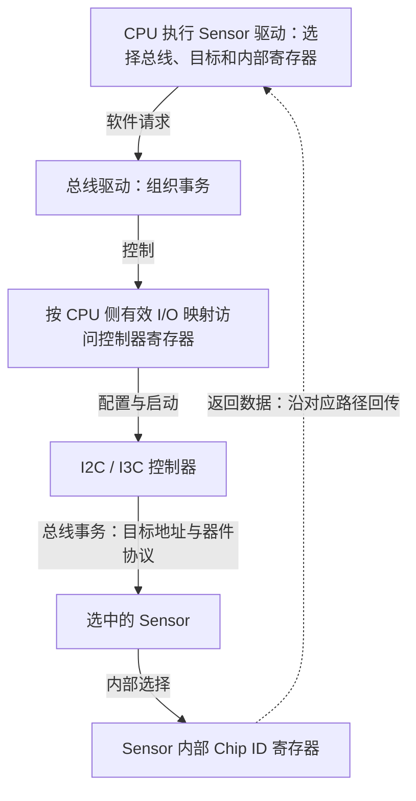

# S1-03：地址空间与内存映射

## 课程信息

- 课程 ID：S1-03；模块：02 处理器与存储。
- 前置：[S1-02 存储类型](Memory_and_Address_Spaces.md)，用户已于 2026-10-16 确认掌握。
- 日期：2026-10-16（Asia/Shanghai）。
- 范围：通用地址模型与 Linux v6.8 公开实现概念，不是特定 SoC 的地址表。
- 本课不提供真实芯片寄存器地址，不展开页表、DMA 映射或完整总线时序。
- 学习状态以 [Progress.md](../Progress.md) 为准，文档存在不表示已掌握。

## 本课目标

看到日志、代码或手册中的地址时，能先判断由谁使用、属于什么空间、经过什么映射，再区分 RAM、SoC 寄存器和外部 Sensor 寄存器的访问路径。

## 1. 地址需要上下文

地址可以先理解为某个访问体系中的位置编号。单有一个十六进制数，不足以知道它指向什么。
至少需要问：谁使用、属于什么空间、映射到哪个对象、当前能否访问。

例如同样写作 `0x1000`，在不同进程虚拟空间、AP/MCU 的不同视图或器件内部编号中，都可能含义不同。
这个数值只是教学示意，不是任何芯片的有效地址或寄存器参数，不能照抄访问。

同一数值不保证同一对象；不同数值也可能经映射指向同一个对象。是否相同要核对映射关系。

## 2. Address Space、Memory Map、Memory Mapping

| 名称 | 中文 | 回答的问题 |
|---|---|---|
| Address Space | 地址空间 | 哪个访问主体在什么上下文中使用这一套编号？ |
| Memory Map | 地址分布图/地址表 | 指定硬件视图下，哪些地址区间分配给 RAM、ROM、外设或保留区域？ |
| Memory Mapping | 地址映射 | 一个地址或区域，按什么关系对应到另一个地址或实际资源？ |

硬件可以根据访问的地址区间和平台配置，将请求送往存储控制器或外设接口等目标。
地址表中的某段存在，不代表那里一定有 RAM；外设寄存器也可以占用可寻址区域。
映射关系可能由硬件固定，也可能需要软件配置；不是所有平台都使用相同方式。

例如将一段地址映射到 DDR，是建立访问关系，不是把 DDR 中的数据复制到新区域。
建立映射也不会自动给 DDR 上电、让已释放 Buffer 重新有效，或恢复掉电丢失的内容。

## 3. 虚拟地址与物理地址：先认识两层

在典型有 MMU 的 Linux 系统中，程序通常使用虚拟地址（Virtual Address，VA）。系统配置地址转换，使其对应到 CPU 物理地址（Physical Address，PA）所描述的资源，并施加相应访问属性和权限。

```text
CPU 使用当前上下文的虚拟地址 V
  → 按已配置的映射进行地址转换
  → 对应 CPU 物理地址 P
  → 经平台互联访问 RAM 或外设资源
```

这是逻辑访问模型，不是每次操作都按顺序访问所有物理模块；缓存、TLB 等细节后续再学。
Linux 官方 DMA 指南明确区分 CPU 虚拟地址、物理地址和设备 DMA 地址。本课只建立分类意识，不展开 DMA API。[Linux v6.8 DMA 指南](https://www.kernel.org/doc/html/v6.8/core-api/dma-api-howto.html)

因此：
- 一个 C/C++ 指针值，在该 Linux 语境下不能直接当作物理地址。
- 两个进程中相同数值的虚拟地址，可能映射不同资源，也可能经共享映射访问同一资源。
- 某些 MCU 软件没有这层虚拟地址转换，但仍受硬件地址表、可达路径、访问权限及资源状态约束。
- 物理地址也要说明是哪一处理器的硬件视图；AP 与 MCU 的地址窗口和别名是否一致需查平台资料。

不需要现在掌握页表，只需记住：程序看见的编号与硬件资源之间可能隔着一层转换。

## 4. Camera 工作中的三种对象

| 对象 | 地址的语境 | 怎样访问 | 地址依据 |
|---|---|---|---|
| 图像 Buffer | 运行内存；需要区分 CPU VA、PA 和设备 DMA 视图 | CPU 经内存访问路径读写；硬件写入用其支持的配置 | 分配与映射结果、平台内存布局 |
| SoC I2C/I3C 控制器寄存器 | 控制器在 CPU 硬件地址表中的寄存器区域，软件可能先取得映射 | 通过对应的 MMIO 访问机制配置控制器 | SoC 手册、资源描述、驱动映射 |
| Sensor 内部寄存器 | 目标器件自己的寄存器编号/选择规则 | 驱动组织总线事务，由控制器发送到指定 Sensor | Sensor 手册及其寄存器协议 |

对象类型与地址空间是两个维度：RAM 和 MMIO 都可能通过虚拟映射访问；不能用“这看起来像指针”判定它一定指向 RAM。

### 控制器基址与寄存器偏移

手册常给出控制器区域基址（Base Address）及某寄存器的偏移（Offset）。在手册定义的同一地址视图和偏移单位下，可以用：

```text
寄存器位置 = 对应区域基址 + 该寄存器偏移
```

本课用符号表示，不给虚构参数。若驱动取得的是映射后的 I/O 基址，就应在对应软件视图中使用偏移，不混加另一空间的基址。
实际偏移单位、访问宽度、对齐和语义查手册；不能凭公式自行猜测。
Linux MMIO 通常需要获取和映射 I/O 资源，并使用适合的访问接口；S1-04 再展开。[Linux v6.8 设备 I/O 文档](https://www.kernel.org/doc/html/v6.8/driver-api/device-io.html)

### Sensor 寄存器编号不能直接当 CPU 指针

在本课采用的 I2C/I3C 外部 Sensor 方案中，通常需要明确：

```text
哪个控制器/总线
  + 哪个目标器件地址
  + 该器件内部哪个寄存器
  + 数据长度、读写方向及器件访问格式
```

总线目标地址选择器件，寄存器编号选择器件内部位置；它们都不是 SoC 控制器的 MMIO 基址。
CPU 对一个数值做指针解引用，只会按当前 CPU 地址访问语义处理，不会自动把这个数值转换成 Sensor 总线读取。
要达到 Sensor，必须经过相应软件和控制器事务路径，除非特定平台另有明确的硬件桥接机制。

Linux I2C 文档将总线选择、目标器件地址和寄存器/命令参数分别处理，可作为公开实现例子。其示例不是所有 Sensor 的寄存器协议，不应直接照用某个 SMBus 格式。[Linux v6.8 I2C 接口](https://www.kernel.org/doc/html/v6.8/i2c/dev-interface.html)
I3C 的地址管理与事务规则不同，详细内容见后续 S2-07；本课只共用“目标器件与器件内部位置需要区分”的思路。

## 5. 一次 Chip ID 读取的逻辑访问路径

下图用于区分 CPU 侧控制器资源与器件内部寄存器，是简化逻辑调用/控制图，不是电气波形或原理图。



图中返回箭头聚合了器件输出、控制器接收及软件取结果；中断、轮询、DMA 和错误处理均省略。
驱动不一定每次新建映射；已有映射可以在其有效生命周期内使用。
某些平台由其他固件代理控制器，实际路径需按平台调整。

## 6. AP 中有效的地址，能否直接给 MCU

不能仅复制数值就假定 MCU 可以访问同一份数据。
例如 AP 的指针 V 指向图像 Buffer，在 AP 上可读，只证明当前 AP 上下文的这次访问成功，不证明：
- MCU 具有同样的地址转换和窗口；
- MCU 可以访问那块存储且有权限；
- Buffer 没有释放或复用；
- 所需资源在当前状态可用。

跨处理器协议通常需约定共享区域、双方视图、偏移/标识、范围、所有权与生命周期；具体协议不在本课制定。
有些系统可约定使用同一地址数值，但必须有映射与接口契约支持，不能从数值相同推导。
即使两端已指向同一块存储，数据同步与 Cache 一致性仍需单独处理，留到 S1-07/S4-04。

## 7. 访问一个地址需要哪些条件

可用检查顺序：
1. 识别类型：这是 CPU VA、某处理器 PA、设备 DMA 地址，还是外设内部编号？
2. 确认对象与范围：它对应哪段资源、长度多少、对象是否还有效？
3. 核对映射与权限：当前访问方能否到达并被允许读写/执行？
4. 核对硬件状态：供电、时钟、复位、初始化等是否满足？
5. 核对访问规则：宽度、对齐、属性和接口是否匹配？

不要对未知 MMIO 地址反复试读；真实寄存器读取也可能有副作用。观察应基于手册和驱动定义。
把一个数字强制转换成指针，不会自动建立映射、授予权限或激活外设。

## 8. 工程锚点：AP 能读 Buffer，MCU 读同一个数值却异常

类型：模拟教学问题，尚无实测结果，不是真实产品根因。

### 现象

假设 AP 能读取某图像 Buffer，向 MCU 发送 AP 指针数值后，MCU 读取异常或内容不符。

### 系统背景

AP 使用带地址转换的系统；MCU 地址视图及跨核接口约定待核对，是否存在共享可达区域未知。

### 相关原理

AP 虚拟地址不自动成为 MCU 的有效地址；地址值、映射和资源状态是不同条件。

### 可能原因

优先核对发送的地址类型与 MCU 视图，其次检查共享区域的可达性、权限、生命周期和存储状态。映射正确后再排查同步/一致性。
排序依据为本例直接复制 AP 指针的触发方式，不是已确认根因。

### 验证方法

检查地址来源、平台内存图、AP 映射和 MCU 可达范围；核对 IPC 字段约定。
在授权且双方可用的共享测试区，使用已确认的双方地址/偏移与长度验证访问，再核对 Buffer 生命周期和数据交付。
不在未知资源或权限条件下盲读，不覆盖采集正在使用的数据。

### 定位过程

当前没有实验结果，不声称确定是哪种映射、权限或硬件状态问题。

### 解决方案

按证据修正 IPC 地址/标识约定并建立正确访问路径；需要时由有访问能力的一方代理或搬运数据。
若硬件不可达，单纯改指针类型不能解决；映射、所有权、同步和掉电恢复需配套验证。

### 经验总结

日志中的地址必须带访问者、空间和来源；“AP 上可读”不能单独证明“MCU 上可读”。
关联 [嵌入式软件协同](../08_Embedded_Software/README.md) 与 [调试方法](../09_Debugging_Bringup/README.md)。

## 9. 理解检查

1. 两个进程打印出的指针数值相同，是否一定指向同一块 RAM？还需要核对什么？
2. Sensor 手册给出一个内部 Chip ID 寄存器编号，为什么不能直接把它当 CPU 指针读取？除编号外，还需明确哪些信息？
3. AP 能读取图像 Buffer，将 AP 指针数值直接交给 MCU，为什么不能保证 MCU 读到同一图像？请说出两个需要检查的条件。

仅按用户实际回答更新进度；未收到回答时不推定理解或掌握。

## 关联课程与依据

- 前一课：[S1-02](Memory_and_Address_Spaces.md)。
- 下一课：[S1-04：寄存器与 MMIO 的具体控制语义](Registers_and_MMIO.md)。
- [硬件接口](../04_Hardware_Interfaces/README.md)、[Camera](../05_Camera/README.md)、[术语速查](../Glossary.md)。
- 来源：S02（本课于 2026-10-16 复核）、S18、S19，版本范围见 [Sources.md](../Sources.md)。
- 本文不包含真实 SoC/Sensor 寄存器地址或公司私有实现。
