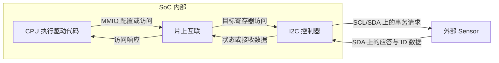

# S1-05：控制器、片上互联与外部总线

## 课程信息

- 课程 ID：S1-05；模块：02 处理器与存储，关联 04 硬件接口。
- 前置：[S1-03 地址空间](Address_Spaces_and_Mapping.md)、[S1-04 寄存器与 MMIO](Registers_and_MMIO.md)，用户已确认掌握。
- 日期：2026-10-19（Asia/Shanghai）。
- 范围：通用分工模型、典型硬件 I2C 控制器方案与 Linux v6.8 公开实现。
- 本课不绑定真实 SoC/Sensor，不提供真实地址、Chip ID、寄存器宽度或固定启动时序；不展开完整 I2C 波形。
- 学习状态以 [Progress.md](../Progress.md) 为准。

## 本课目标

沿一次 Sensor Chip ID 读取，说明软件、CPU、片上互联、控制器与外部总线分别承担什么，并用分层证据判断读取请求走到了哪里。

## 1. 三个容易混用的词

| 概念 | 是什么 | 在本课中的职责 |
|---|---|---|
| 控制器（Controller） | 执行特定接口操作的硬件模块 | 按配置发起 I2C 事务、收发数据、记录完成或错误 |
| 片上互联（On-chip Interconnect） | 连接芯片内部功能模块的通信结构 | 将 CPU 的设备访问请求送往目标控制器，并返回响应 |
| 外部总线（External Bus） | 芯片之间按接口规则通信的连接 | 在本例中通过 SCL/SDA 连接 SoC 的 I2C 控制器与 Sensor |

控制器通常同时有“面向 CPU 的寄存器接口”和“面向外设的协议接口”。前者供软件配置和读取状态，后者执行外部通信；两侧不是同一个协议。
软件驱动也是 CPU 执行的程序，不是位于 CPU 与控制器之间的一块硬件。

Arm 的 AMBA（Advanced Microcontroller Bus Architecture）是连接 SoC 功能模块的协议体系，例如 AXI（Advanced eXtensible Interface）、AHB（Advanced High-performance Bus）和 APB（Advanced Peripheral Bus）。这里只识别其片上连接用途，不学习信号细节，也不假定目标芯片采用某个固定拓扑。[Arm AMBA 官方介绍](https://www.arm.com/architecture/system-architectures/amba)

本课的“片上/外部”用于区分所选 SoC 内部访问与到 Sensor 的板级连接，不是对所有接口使用范围的绝对分类。

## 2. 把软件调用链与硬件访问路径分别画清楚

下图是典型硬件控制器方案的逻辑图，用于识别控制请求和返回路径；不是实际芯片框图。省略地址转换、互联桥、时钟/电源域、安全检查、引脚复用电路及完成通知布线。它们是否存在、如何连接，须看目标平台。



对这个图要分清：

- CPU 经片上互联读写的是控制器的 MMIO 接口。
- 控制器在外部 I2C 总线上执行的是到目标 Sensor 的通信。
- Sensor 内部 Chip ID 寄存器编号是本次通信中的器件协议参数，不会因此成为 CPU 可直接解引用的地址。
- 返回 ID 可先到控制器接收资源，再由驱动放入调用者 Buffer。本例采用 CPU 读取接收数据的教学方案；有的平台可使用 DMA，不将 DMA 当作读取 Chip ID 的必需环节。

MMIO 访问细节仍见 [S1-04](Registers_and_MMIO.md)，地址上下文见 [S1-03](Address_Spaces_and_Mapping.md)，本课只把它们连到总线事务。

## 3. Linux 示例：为什么有两类驱动

Linux v6.8 I2C 使用 adapter/client 等术语，文档还保留 master/slave；本课用 Controller/Target 说明发起与响应角色。软件中的 adapter 也可能对应复用器后面的逻辑总线，不能从一个软件编号直接推定一个物理控制器。[Linux I2C 分层概览](https://www.kernel.org/doc/html/v6.8/i2c/summary.html)

典型调用关系：

```text
CPU 执行以下软件调用：
Sensor 驱动
  → I2C Core（公共框架）
  → I2C Adapter/控制器驱动
  → 平台设备访问接口

随后由配置好的控制器硬件执行外部事务。
```

| 软件层 | 主要知道什么 |
|---|---|
| Sensor 驱动 | Sensor 寄存器含义、Chip ID 位置/长度/编码，以及配置与开流要求 |
| I2C Core | 按框架规则协调请求、锁与适配器调用等公共工作 |
| 控制器驱动 | 当前控制器寄存器、命令组织、收发资源和完成/错误处理方式 |

Sensor 驱动通常把“目标地址、要发的字节、接收长度”提交给总线框架，不需要为每一种控制器重写 Sensor 寄存器语义。控制器驱动执行通用字节传输，不会自动知道这些字节是不是 Chip ID。[Linux I2C 设备驱动指南](https://www.kernel.org/doc/html/v6.8/i2c/writing-clients.html)

这是 Linux 公开实现示例，不能把同名 API 或层级直接套到 RTOS/厂商固件。

## 4. 一次 Chip ID 读取，实际包含什么

教学设定：Sensor 支持“先发送内部寄存器编号，再读取 ID”的组合事务；目标控制器支持所需消息组合。寄存器编号的字节数/顺序、ID 长度/编码和启动条件均须查实际 Sensor 资料。

```text
选择正确总线与目标 Sensor
  → 发送 Chip ID 寄存器编号
  → 按器件要求切换到读取阶段
  → 接收 ID 字节
  → 检查事务结果与数据长度
  → 按器件格式解码、核对预期 ID
```

“读寄存器”可以包含一个写消息：这里写入的是要访问的内部编号，不是修改 Chip ID 值。部分器件要求写编号与读数据之间使用重复起始（Repeated START），另一些访问格式不同；不能随意拆成两次带 STOP 的调用。[Linux I2C 事务概览](https://www.kernel.org/doc/html/v6.8/i2c/i2c-protocol.html)

不提供真实地址，也不以普通指针读取 Sensor 内部寄存器。请求至少要明确：总线路径/实例、目标地址及格式、寄存器编号及编码、读写消息组合、接收长度和输出 Buffer。

| 阶段 | 软件动作 | 硬件行为 | 可观察证据 |
|---|---|---|---|
| 准备 | 核对总线选择、访问格式与资源条件 | 控制器和 Sensor 处于允许通信的状态 | 配置、资源状态及器件资料；不能仅凭一次成功日志断言全部成立 |
| 下发 | 控制器驱动组织命令和发送内容 | 片上访问到达控制器 | 驱动调用记录及可安全读取的控制器状态 |
| 执行 | CPU 等待或处理传输进展 | 控制器产生协议时序，Sensor 接收编号并返回数据 | 正确引脚上的事务与应答；不在本课展开电气判读 |
| 收尾 | 处理完成/错误，将数据交给调用者 | 接收数据可用，完成状态按硬件定义更新 | 本次事务状态、返回值、实际长度和 Buffer 内容 |
| 识别 | 按器件格式解码、比较 ID | 无需因此启动图像输出 | 返回字节与器件资料匹配；不是仅检查“非零” |

在此硬件控制器方案中，CPU 负责运行软件、准备参数及处理结果；控制器执行协议时序。CPU 仍可能参与填充/排空收发资源，不等于 CPU 每个 SCL 周期都在翻转 GPIO。
GPIO 模拟 I2C 是另一类实现，不能将本课分工无条件用于它；本课也不假设所有控制器都需要一个独立 START 命令寄存器。

## 5. 返回成功到底证明到哪一步

沿用 [S1-04 的完成语义](Registers_and_MMIO.md#6-软件发起写到达与工作完成是不同阶段)：提交、硬件执行、数据有效要分别确认。

Linux v6.8 `i2c_transfer()` 是同步传输接口，返回负错误码或已执行的消息数。若请求两个消息，完整成功应核对返回值为 `2`，不能把“非负”或“等于 0”作为所有 API 的统一成功判断。其他接口可能返回字节数、数据值，或采用异步回调，按各自契约解释。[Linux v6.8 I2C API](https://www.kernel.org/doc/html/v6.8/driver-api/i2c.html)

| 已有证据 | 可以支持的结论 | 仍不能推出 |
|---|---|---|
| 驱动进入读取函数 | 软件运行到了该处 | 控制器已启动或引脚上已有事务 |
| 目标地址阶段有 ACK（Acknowledge，应答） | 在该次事务条件下有目标作出应答 | 器件身份正确、整次读取完成或已经出图 |
| 本次读取完整成功，ID 与资料匹配 | 在当前条件下读通了该标识控制路径 | Sensor 全功能正常、CSI 接收/ISP/DMA/Buffer 通路可用 |

外部读事务结束时，Controller 发送 NACK（Not Acknowledge，非应答）可以是正常终止读取的一部分；不能把任意位置的 NACK 都当成同一种失败。[I2C 事务中的 ACK/NACK 位置](https://www.kernel.org/doc/html/v6.8/i2c/i2c-protocol.html)

在智能眼镜中，Chip ID 读通只是 Camera Bring-up 的一个控制路径检查。TWS 中通过控制接口读 Codec/传感器 ID 也采用相似分层思路；不能据此推定具体 TWS 芯片连接方式。

## 6. 工程锚点：日志进入读函数，但 Chip ID 未读到

类型：模拟教学问题，尚无真实测量结果或已确认根因。

已知事实只有“读函数入口日志出现，最终报告失败”；失败发生在准备、传输还是 ID 比较阶段尚未知。

| 待验证分支 | 验证动作与证据 | 用来缩小哪一段 |
|---|---|---|
| 参数/路由不匹配，或请求提前返回 | 记录本次总线路径、目标地址格式、寄存器编码、长度、返回值及时间 | 软件是否向预期控制器提交了正确请求 |
| 控制器或引脚路径条件不满足 | 按平台资料核对供电、时钟、复位、权限和引脚复用；在正确位置观测 | 是否进入外部事务执行阶段 |
| 目标没有按预期响应 | 将目标地址阶段/后续阶段与器件供电、复位及必要时钟条件关联 | 总线目标及访问前提；NACK 不等于唯一根因是掉电 |
| 传输完成但 ID 不符 | 核对完整返回长度、原始字节、寄存器/字节序和预期器件；确认未使用失败后的旧 Buffer | 传输、数据解释和器件身份三者的区别 |

在正确测点未见波形时，先核对软件是否真正提交、选中的总线/引脚是否正确及控制器条件，不凭入口日志断言 Sensor 损坏。
日志和状态采样遵守 [寄存器副作用规则](Registers_and_MMIO.md#5-读写语义决定这个值是什么意思)，不能为调试随意重复读清除状态或 FIFO。
先形成可关联的证据，再选择修正参数、恢复资源或调整事务等措施；当前没有实验结果，不宣布任何分支已定位或修复。
独立案例和完整电气排查在后续课程建立，方法入口见 [Bring-up](../09_Debugging_Bringup/README.md)。

## 7. 理解检查

1. 在硬件 I2C 控制器方案中，CPU、片上互联、I2C 控制器各负责什么？正常事务中的 SCL 时序主要由谁执行？
2. 读取 Sensor Chip ID 时，为什么“读”可能包含一个写消息？控制器 MMIO 地址、总线目标地址、Sensor 内部寄存器编号分别用来选择什么？
3. 日志显示已进入读函数，但在确认正确的测点没有看到 I2C 波形，能否据此判断 Sensor 损坏？你会先检查哪两类条件？

不预填用户回答；仅按实际反馈登记理解检查和掌握确认。

## 关联课程与来源

- [前一课 S1-04](Registers_and_MMIO.md)、[地址空间 S1-03](Address_Spaces_and_Mapping.md)、[硬件接口模块](../04_Hardware_Interfaces/README.md)。
- [下一课 S1-06](Interrupts_and_Polling.md)：中断与轮询，继续连接硬件状态、CPU 通知和软件处理。
- S23～S26 为本课新增公开依据，版本和适用限制见 [Sources.md](../Sources.md)；不声称已核对完整 I2C 或 AMBA 规范条款。
