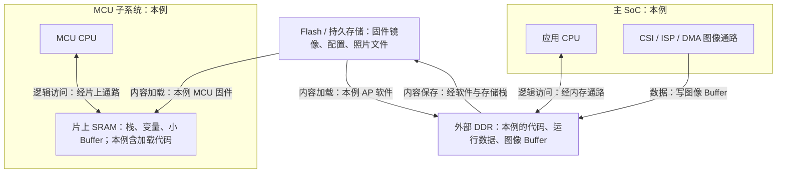

# S1-02：SRAM、DRAM/DDR、Flash 与 ROM

## 课程信息

- 课程 ID：S1-02；模块：02 处理器与存储。
- 前置：[S1-01 处理器角色](Processor_Roles.md)，用户已于 2026-10-16 确认掌握。
- 建立日期：2026-10-16（Asia/Shanghai）。
- 范围：通用存储原理、典型眼镜数据放置与模拟故障；未指定实际器件。
- 文档状态：已建立并核对相关公开资料；学习状态以 [Progress.md](../Progress.md) 为准。
- 本文负责 S1-02 存储类型；地址空间、映射、权限和地址含义在独立的 [S1-03](Address_Spaces_and_Mapping.md) 展开。

## 本课目标

面对眼镜中的固件、运行变量、图像 Buffer 和照片文件，能说明它们适合放在哪里、断电后哪些内容失去有效性，以及休眠时应检查哪些存储条件。

## 1. 先区分用途、技术与状态

先问三个问题：
1. 这份内容是要长期保存，还是运行时反复读写？
2. 承载它的是哪类存储，是否依赖持续供电和刷新？
3. 当前处理器/外设是否能访问这块存储？

RAM（Random-Access Memory，随机存取存储器）在本课的嵌入式工作语境中主要指 SRAM/DRAM 等运行内存；“随机存取”不是随机写入，而是不必依序访问所有前面的内容。
这是常用分类语境，并不意味着只有 RAM 技术能随机读取，也不包含所有新型存储技术。

Buffer（缓冲区）描述一块内存的用途，不是新的存储芯片类型。Camera Buffer 可以位于 DDR，也可以在条件允许时位于 SRAM。

## 2. 四类存储的基本区别

| 名称 | 英文 | 断掉实际供电后的有效内容 | 维持内容的机制 | 典型用途 |
|---|---|---|---|---|
| SRAM | Static Random-Access Memory | 普通 SRAM 不能保证保留 | 供电条件满足时无需 DRAM 式周期刷新 | MCU 运行数据、小 Buffer、部分代码或片上缓存实现 |
| DRAM | Dynamic Random-Access Memory | 不能保证保留 | 需要供电与刷新机制 | 较大运行内存、图像 Buffer、模型与工作数据 |
| Flash | Flash Memory | 正常器件和保持条件下可保留已正确写入内容 | 非易失性存储，可电擦写 | 固件镜像、配置、照片与文件 |
| ROM | Read-Only Memory | 本课只读非易失启动存储语境下可保留 | 依具体实现；Mask ROM 内容出厂固化 | 启动代码、固定例程等 |

SRAM 与 DRAM 称为易失性存储（Volatile Memory）；Flash 属于非易失性存储（Non-volatile Memory）。保留时间、耐久性、错误处理和写入保证仍取决于器件与系统。
Micron 的官方介绍将移动 LPDRAM 与 Flash 持久存储分开说明。[Micron Memory vs Storage](https://www.micron.com/markets-industries/mobile)

### SRAM 的 Static 不代表不怕断电

“静态”表示在满足供电等条件时不需要像 DRAM 那样周期刷新，不表示不需要电。
独立保留电源或备份供电可能使一块 SRAM 跨某些系统状态保留，但这不是普通 SRAM 完全断电后仍保持数据。
Infineon 明确将普通 SRAM 描述为无需刷新、但易失的存储。[Infineon SRAM](https://www.infineon.com/products/memories/sram-static-ram)

### DRAM 为什么需要刷新

可以将常见 DRAM 存储单元直觉理解为用电荷表示信息；电荷会泄漏，需要在规定条件下刷新来保持内容。
刷新通常由内存控制器配合器件机制管理，进入自刷新时由器件内部机制维持，不是应用线程逐字节重写。
正常工作仍需满足供电、初始化和访问路径等条件；具体刷新周期不在没有数据手册时给数值。

自刷新（Self-refresh）是保留机制，不等于断电，也不等于此时允许正常读写。
Micron 的 DDR FAQ 说明其所讨论的自刷新仍需满足器件供电要求；具体电压、模式和退出步骤不能推广到所有 DDR/LPDDR 代际。[Micron FAQ](https://www.micron.com/sales-support/sales/faqs)

### ROM 与 Flash 的命名边界

ROM 是只读存储语境，Flash 是可擦写存储技术；系统资料中的“ROM 区域”不总能直接证明物理实现为 Mask ROM。
本课提到 BootROM，只建立“启动时可用的一段固化/只读代码与承载区域”的位置感，不推定所有芯片的启动入口和底层工艺。
Mask ROM 不能像普通用户 Flash 一样擦写更新；Flash 的升级也必须通过相应流程。
NXP 的 AN2200 对两个历史 MCU 的 Mask ROM 和可擦写 Flash 做了明确对照；本课只引用这个区别，不迁移其参数与地址。[NXP AN2200，第 2.1 节](https://www.nxp.com/docs/en/application-note/AN2200.pdf)

## 3. DDR、LPDDR 与 DRAM 的关系

- DRAM：存储技术的大类。
- DDR（Double Data Rate，双倍数据率）：描述数据传输特性；在本课常指相应 DDR SDRAM 存储家族。
- LPDDR（Low-Power Double Data Rate，低功耗双倍数据率）：低功耗 DRAM 家族，常见于移动系统。

因此在本课的系统内存语境中，DDR/LPDDR 都属于 DRAM，不要把它们当成与 DRAM 并列的三种物理存储原理。
“DDR”这一传输术语也可用于其他接口，本课不把所有名称中有 DDR 的器件都判定为 DRAM。

DDR 的“双倍”指在相关时钟上升沿和下降沿传输数据，不是容量翻倍，也不能据此推定应用性能翻倍。[Micron DDR5 FAQ](https://www.micron.com/products/memory/dram-components/ddr5-sdram)
LPDDR 名称见 [Micron 移动内存介绍](https://www.micron.com/markets-industries/mobile)。

## 4. 固件存在哪里，与代码在哪里执行

固件是软件内容，Flash/SRAM/DRAM 是承载内容的存储。它们不是同一分类。

典型方案有两种：

| 方案 | 非易失存储的作用 | 执行位置 | 需要确认 |
|---|---|---|---|
| Load and Run：加载后执行 | 保存固件镜像 | 将所需代码加载至 SRAM/DRAM 后执行 | 加载流程、执行区域、存储是否已可用 |
| XIP：Execute In Place，就地执行 | 保存代码并作为取指来源 | 从支持直接取指的映射存储执行，可经过缓存 | 器件、控制器、映射、权限与取指路径是否支持 |

ST 的 External Memory Manager 明确区分 XIP 与加载到 RAM 执行的流程；其内存初始化条件是公开实现例子。[ST 官方说明](https://wiki.st.com/stm32mcu/wiki/Introduction_to_External_memory_Manager)
不是所有 Flash 接口、存储产品或代码格式都支持 XIP。不能将 NAND 文件存储等同于 CPU 可直接取指的地址区域。

同一系统可以混用两种方案，代码、栈、堆与其他数据也可能位于不同区域。具体位置由启动流程、链接/加载布局和系统配置决定。
本课不深入链接脚本或虚拟地址；后续 S1-03/S1-08 再展开。

## 5. 放回智能眼镜的存储分工

典型教学方案假设：独立 MCU 有片上 SRAM；主 SoC 连接外部 DDR；Flash 存储固件和文件。
下面是内容放置与逻辑访问图，不是真实电路图；加载动作由启动代码与控制器等完成，不是 Flash 自发向 RAM 写入。



本图选择加载执行，XIP 是另一种方案；不代表 MCU 所有代码都必须加载至 SRAM。
省略供电、时钟、复位、缓存、权限、启动入口与实际接口；真实产品可能使用不同器件或存储集成方式。
Flash 框按用途聚合，不要求固件与照片一定在同一个器件。
完整模块位置参照 [眼镜系统框图](../01_System_Architecture/README.md#典型智能眼镜功能框图)。

## 6. Camera Buffer 不等于照片已保存

在本例中：Sensor 输出 → 接收/处理 → DMA/内存通路写 DDR Buffer → 软件消费图像。
这一步只表明产生了运行时数据。若需要保存照片，还需按业务进行编码或封装，并通过存储路径将内容正确持久化。
文件格式不一定是 JPEG；写接口返回的含义与落盘保证也要看存储栈，不能把“已发起保存”当作掉电后一定完整。

Buffer 是被程序/硬件用作缓冲的一段内存，不是 Flash 文件，也不一定就是 DDR。
一般不会把 Flash 当作每帧反复改写的工作 RAM：需考虑编程/擦除规则、延迟、耐久性及接口；具体限制看产品资料。

### 为什么图像容量影响存储选择

教学假设：1920 × 1080、RAW10，采用紧密的 10 bit/像素打包，仅计算有效像素载荷。

```text
每帧字节数 = 1920 × 1080 × 10 ÷ 8
           = 2,592,000 B，约 2.47 MiB
4 个同规格 Buffer = 10,368,000 B，约 9.89 MiB
```

这里 1 MiB = 1,048,576 B。未计入 stride 对齐、元数据、嵌入数据、格式展开及其他中间 Buffer。
如果 RAW10 在内存中按更宽单元展开，实际大小会不同；先确认内存格式再计算。
是否使用 SRAM，必须看可用容量、接口与带宽，不能说“SRAM 绝对不能存图像”；这个估算说明大 Buffer 为什么常需要更大容量的工作内存。
这些数值来自假设计算，不是任何实际 Sensor 的参数。

## 7. 数据还在、存储可访问、数据仍有效是三个条件

| 条件 | 例子 | 软件要确认的内容 |
|---|---|---|
| 内容保留 | DDR 处于满足要求的自刷新 | 保留供电和模式是否成立 |
| 允许访问 | 内存控制器/PHY/互联恢复到可读写状态 | 完成恢复和访问条件后再使用 |
| 内容有效 | Buffer 仍属于当前采集会话、布局和所有权匹配 | 不能只因旧地址数值还在就使用 |

AP CPU 暂停不等于 DDR 断电；DDR 保留内容不等于 MCU 随时能访问。
如果 DDR 完全失去保持条件，恢复供电后不能继续信任旧内容，需按方案初始化、重建或重载。
具体故障可能表现为异常、超时、挂起或错误数据，不能在没有平台证据时断言某一种必然出现。

### 完全掉电后，如何恢复 Camera 采集

先区分两个目标：旧图像没有其他副本时，不能依靠重新上电或旧地址找回；恢复采集则是让系统重新产生一帧有效图像。

以下为教学层次的恢复流程，不是适用于所有芯片的固定寄存器顺序：
1. 恢复存储可用条件：按平台要求恢复 DDR、内存控制器及相关资源，确认可以正常访问；不能仅检查供电。
2. 重新建立或确认有效 Buffer 与状态：核对可用内存、分配和访问条件，重新准备必要的描述信息，并将已丢失的旧图像标记为无效。实际地址可以复用，不代表旧内容复原。
3. 恢复必要的采集配置并重新采集：让 Sensor 输出，经接收/处理与 DMA 等内存写入通路填充 Buffer；是否需要重配各模块由其状态决定。
4. 等待新帧完成并确认有效后，再把它交给后续软件。准备好空 Buffer 不代表已经有图像。

若原先还有代码或必需状态放在已掉电的 DDR，也需先恢复相应运行环境；这不等于必须重新烧录 Flash。

## 8. 工程锚点：MCU 运行正常，但访问旧图像 Buffer 异常

类型：模拟教学问题，没有实测日志或已确认产品根因。

### 现象

假设休眠后 MCU 仍响应命令，但读取先前的图像 Buffer 时异常。

### 系统背景

本例 MCU 代码、栈和命令数据都位于保留条件满足的本地 SRAM；图像 Buffer 位于主系统 DDR。
DDR 当前是掉电、自刷新还是已恢复未知；该方案休眠前允许 MCU 经系统互联访问 DDR。

### 相关原理

处理器可以访问的资源有不同状态；MCU 自身能执行并不能证明 DDR 可访问，更不能证明旧图像仍有效。

### 可能原因

1. DDR 未恢复可访问条件，或已掉电导致旧内容失效。
2. 内存控制器、PHY、互联或权限未恢复。
3. Buffer 已释放、复用，或会话/描述信息失效。
4. 后续仍需考虑地址映射、一致性等问题；本课只建立位置与有效性意识。

优先级基于休眠触发及分域依赖，不是已确认的发生概率。

### 验证方法

先核对系统图、存储布局和低功耗设计；从保持可用的日志/调试资源确认 DDR 与控制器状态。
对比冷启动与恢复路径；在平台确认内存可访问后，用授权测试区验证读写，再确认 Buffer 生命周期与内容。
不要在未知资源状态下反复盲读作为第一项实验；测试也不能覆盖仍在使用的数据。

### 定位过程

当前无实验结果，仅有教学设定；没有排除分支，也没有确认根因。

### 解决方案

候选措施依证据选择：先恢复内存资源再访问；若内容丢失则重新加载代码/状态、建立 Buffer 并重新采集；小规模必需状态可考虑放入合适的保留存储。
保留资源与恢复顺序、能耗和容量需根据实际平台设计；未声称修复验证完成。

### 经验总结

先问代码在哪里、运行数据在哪里、Buffer 在哪里；再问它们在当前状态是否仍可访问和有效。
关联 C04/C09 的规划入口见 [工程案例导航](../10_Engineering_Cases/README.md)，本课堂问题不重复建立独立案例。

## 9. 理解检查

1. MCU 的普通 SRAM 断掉实际供电后，原变量是否还能保证保留？“Static”指什么？
2. 同一份固件镜像保存在 Flash，是否说明 CPU 一定从 Flash 执行？说出两种执行方式，并区分“重新加载”和“重新烧录”。
3. 已采集图像只在 DDR Buffer，尚未保存到持久存储。DDR 完全掉电后，能否仅凭旧地址取回图像？恢复时应做什么？

反馈只按用户实际回答记录，不因本篇已生成就标记理解或掌握。

## 关联课程与来源

- 下一课：[S1-03：地址空间、Memory Mapping 与访问上下文](Address_Spaces_and_Mapping.md)。
- [S1-01 处理器角色](Processor_Roles.md)、[电源时钟](../03_Power_Clock/README.md)、[Camera](../05_Camera/README.md)、[固件与恢复](../08_Embedded_Software/README.md)。
- 本课公开依据：S12～S17，查阅于 2026-10-16，版本与限制见 [Sources.md](../Sources.md)。
- 通用教学模型不替代实际芯片手册；本文未引用私有代码或公司内部参数。
