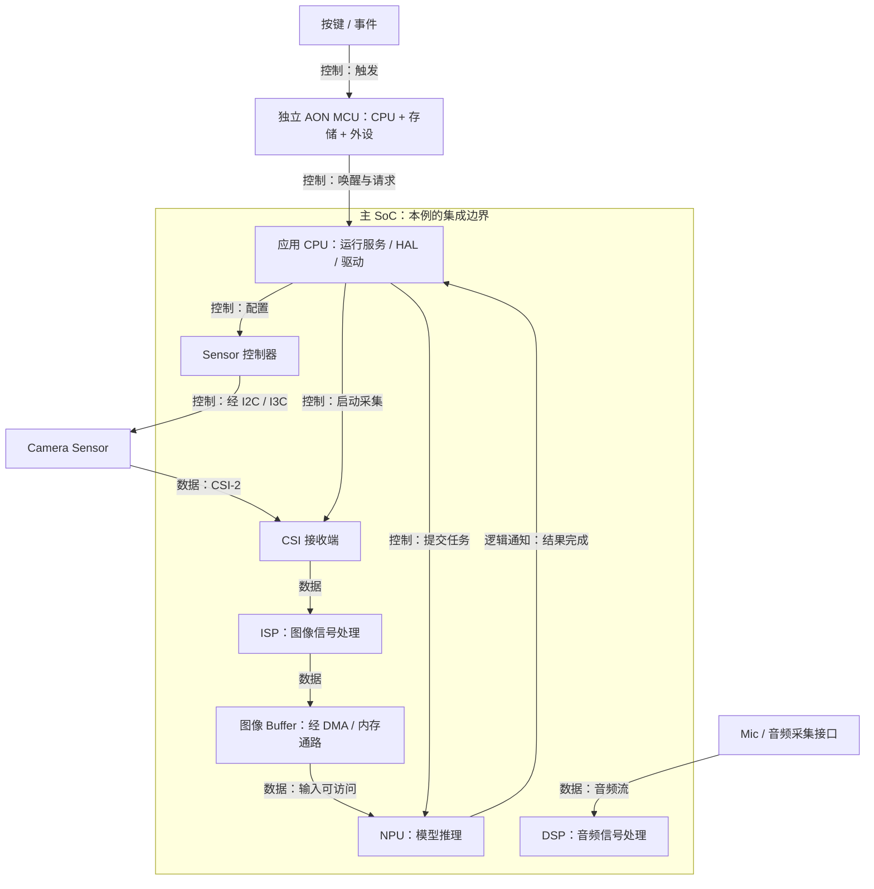

# S1-01：CPU、MCU、AP、SoC、DSP、NPU 的角色与关系

## 课程信息

- 课程 ID：S1-01；所属模块：02 处理器与存储。
- 前置：已有 C/C++ 基础，无额外硬性前置。
- 日期：2026-10-14（Asia/Shanghai）。
- 范围：通用概念与典型教学方案；公开产品仅用于说明集成关系，不代表目标眼镜。
- 文档状态：已建立并核对所引用的公开资料；未指定器件，参数和具体实现不作推定。
- 学习状态以 [Progress.md](../Progress.md) 为准，本文存在不表示已掌握。

## 本课目标

读一张简化眼镜框图时，能区分处理器内核、芯片集成边界和系统角色，并说明：谁运行控制代码，谁处理数据，谁在指定低功耗状态中保留工作。

## 1. 先区分描述层次

CPU、MCU、AP、SoC、DSP、NPU 不属于同一个互斥分类表。

| 名称 | 英文 | 主要描述层次 | 直觉理解 |
|---|---|---|---|
| CPU | Central Processing Unit | 通用指令执行单元；嵌入式讨论中常指内核或核群 | 执行普通程序指令 |
| MCU | Microcontroller Unit | 通常集成 CPU、存储和外设的微控制器芯片；也可指控制子系统 | 为控制任务组织的计算与外设集合 |
| AP | Application Processor | 应用处理器的产品或系统角色，工程口语也常指整颗主处理芯片 | 运行应用与复杂系统软件的主处理平台 |
| SoC | System on Chip | 在一颗芯片内集成多类功能的方式与边界 | 看哪些功能被集成在同一颗芯片中 |
| DSP | Digital Signal Processor | 为数字信号处理优化的可编程处理器 | 高效执行滤波等信号计算 |
| NPU | Neural Processing Unit | 为神经网络计算优化的处理单元/加速器 | 加速支持的神经网络任务 |

这些分类可以重叠：MCU 内有 CPU；应用处理器常以 SoC 实现；一个 SoC 可同时有应用 CPU、微控制器子系统、DSP、NPU 和 ISP。
DSP 也执行程序，不是所有计算都必须由通用 CPU 做；在本文中用“CPU”与 DSP 对照时，指通用 CPU。

工程会议说“AP 出问题”时，要追问指 CPU 核、操作系统还是整颗芯片。说“MCU 模块”时，要确认是独立芯片还是 SoC 内部子系统。

## 2. CPU：执行代码的内核

CPU 的基本工作是取指令、解释并执行指令。你的 C/C++ 程序通常经过编译，成为目标 CPU 可执行的机器指令。

Camera 服务的逻辑、HAL 中的状态处理、驱动的配置代码，可以运行在 CPU 上；实际运行位置依系统设计。
CPU 执行代码能够发起硬件访问，但并不意味着 CPU 自己生成每个总线时钟或逐个像素处理每帧图像。

在 Arm 系统中，Cortex-A 常用于应用处理，Cortex-M 常用于微控制器与控制任务。它们是 CPU 内核系列，并不是带齐所有外设的完整芯片名称。[Arm CPU 架构定位](https://www.arm.com/architecture/cpu)

本课只认识内核与芯片的区别，异常处理、MMU 和指令细节留到后续。

## 3. MCU：CPU 加上控制任务需要的资源

常见 MCU 集成一个或多个 CPU 核、SRAM、部分非易失性存储、GPIO、定时器和串行控制器。具体配置依芯片，不能默认一定有足够的片上 Flash 或不需要外部存储。
例如 STM32H7 家族包含不同单核/双核和存储配置，这是公开产品例子。[ST STM32H7](https://www.st.com/en/microcontrollers-microprocessors/stm32h7-series.html)

在典型眼镜方案中，MCU 可处理按键、IMU、唤醒请求和小规模控制；在 TWS 中也可以参与检测、控制和音频协同。职责由硬件连接、软件分工与功耗需求共同决定。

MCU 常运行裸机或 RTOS 软件，但这不是定义上的绝对限制。
“采用 MCU”也不等于“自动低功耗”：需要相关供电、时钟、存储和唤醒路径在目标状态可用，软件还要正确管理状态。

## 4. AP 与 SoC：系统角色与集成边界

AP 常承担 Camera 服务、较复杂的操作系统、应用、存储及网络业务协调。这里是典型分工，不规定所有产品都使用同一种 OS 或 CPU 系列。

SoC 则说明芯片里集成了什么。集成可以减少外部连接并提供片上协作，但仍可能需要外接 DDR、Flash、PMIC、Sensor 或无线器件。

因此“AP 还是 SoC？”通常需要先澄清问题：它可以同时是承担应用角色的处理器产品，也是集成多类模块的 SoC。
MCU 通常也符合广义片上系统的集成思路，但行业产品分类仍常把 MCU 与应用 SoC 分开称呼；工程上优先读真实模块图。

公开实例：NXP i.MX 8M Plus 家族列出 Cortex-A53、Cortex-M7、NPU、ISP 及音频 DSP。这个例子证明不同功能可以集成；不用于推定眼镜选型或其低功耗域。[NXP 官方产品页](https://www.nxp.com/products/i.MX8MPLUS)

## 5. DSP 与 NPU：计算类型不同，软件仍参与组织

### DSP

数字信号处理常包含重复的乘加、滤波、变换和数据流计算。DSP 的指令、执行单元和数据访问结构针对这类任务优化。
典型眼镜/TWS 可把音频滤波、降噪或回声处理分配给 DSP；具体任务也能由 CPU 或专用硬件承担，名称不是唯一执行位置。

软件通常需要 DSP 的目标工具链、固件、任务接口和调试方法。TI 的公开 DSP 产品将 Arm 核与 DSP 集成，且提供 DSP C/C++ 编译工具，可作为“DSP 可编程”的实现例子。[TI DSP SoC 与工具](https://www.ti.com/product-category/microcontrollers-processors/microprocessors-dsp/audio-radar-dsp-socs/overview.html)

### NPU

NPU 针对神经网络的张量计算提供加速。在眼镜教学方案中，可承担目标检测或其他模型推理。
模型要匹配目标平台支持的算子、数据类型、布局和存储要求；有 NPU 不等于任意模型都能直接执行。

典型软件路径为：准备/转换模型 → 配置输入输出与内存 → 通过运行时/驱动提交任务 → 加速器执行 → 等待完成并处理结果。
例如 Arm CMSIS-Ethos-U 文档说明：Vela 进行部署前编译，运行时由 Cortex-M 应用和推理运行时通过驱动提交命令流与模型内存区域。这也说明 NPU 不仅能与 AP 配合。[Arm CMSIS-Ethos-U](https://www.keil.arm.com/packs/cmsis-ethos-u-arm/overview/)

上述流程是公开实现参考，不假定所有 NPU 都使用同一驱动、编译器或调度方式。

## 6. 放回智能眼镜：谁控制、谁处理、谁保留

下图是简化功能关系图，假设独立 AON MCU 与主 SoC 配合，主 SoC 内有 DSP/NPU。用途是区分角色与集成边界。
控制与数据箭头为逻辑关系，经由控制器、驱动、片上互联或存储等实际路径；不是引脚网表。

Buffer 框表示资源，可能位于外接 DDR，放在功能边界内不表示存储芯片集成在 SoC。
图中省略电源、时钟、复位、资源获取、音频配置及结果存储；完整参照见 [系统架构导航](../01_System_Architecture/README.md#典型智能眼镜功能框图)。
ISP 为 Image Signal Processor；此处仅说明图像处理位置，详细流程见模块 05 的后续课程。
实际产品可以把 MCU 集成进主 SoC，也可以有其他协作路径。

### 一次拍照请求对应的动作

| 步骤 | 软件运行或发起位置 | 硬件工作 | 需要的证据 |
|---|---|---|---|
| 触发与唤醒 | 本例 MCU 固件处理事件并发出请求 | 事件输入、唤醒路径与主域状态转换 | 事件日志、唤醒原因、主域状态 |
| 准备 Camera | 本例应用 CPU 运行服务/HAL/驱动 | 电源/时钟/复位和控制器按方案准备 | 资源状态及必要物理观测 |
| 配置 Sensor | CPU 执行驱动代码，配置控制器 | 控制器产生总线事务，Sensor 接收配置 | 控制器结果、总线、Sensor 状态 |
| 采集与处理 | CPU 配置采集路径 | Sensor 输出，CSI 接收，ISP 处理 | Sensor/接收端/ISP 的分层状态 |
| 写入内存 | CPU 预先准备 Buffer 与硬件配置 | DMA/内存通路写入数据 | 完成状态、Buffer 内容与有效性 |
| 模型推理 | CPU 运行推理运行时并提交任务 | 本例 NPU 执行支持的模型计算 | 提交/完成状态和结果 |

这是典型教学分工，没有给出通用 API、寄存器或时序。厂商平台也可能让 MCU/DSP 固件承担部分驱动控制。
DMA 减少 CPU 逐项搬运，不免除 CPU 的配置、所有权和同步工作；具体映射见 [Linux DMA 指南](https://www.kernel.org/doc/html/v6.8/core-api/dma-api-howto.html)，后续 S1-07 深入。

## 7. 为什么不能把所有工作都放在同一处

分工取决于数据类型、吞吐、完成期限、访问资源、唤醒开销与能耗，不只看处理器频率。
- CPU 适合多样化逻辑与任务组织；能做部分信号/模型计算，效率取决于任务。
- MCU 常适合小规模控制与事件处理；是否能接收图像需检查接口、内存和低功耗资源。
- DSP 适合信号计算；通用程序或神经网络也可能运行，但成本和支持要查平台。
- NPU 加速支持的模型计算；不能代替所有控制代码。

比较低功耗方案时，要比较整个活动窗口及状态转换的能量，包括外设和存储。不能用“MCU 一定省电”或“NPU 一定更快”替代验证。

## 8. 工程锚点：MCU 能唤醒，为什么仍不能出图

类型：模拟教学问题；未实际测量，不是用户产品故障。

### 现象

假设 MCU 在目标低功耗状态能处理按键，但主 SoC 休眠时拿不到图像。

### 系统背景

假设 Sensor 的 CSI-2 仅连接主 SoC；MCU 只有事件、控制与唤醒路径。接收端、图像处理和 Buffer 资源状态未知。

### 相关原理

能够运行控制代码，不代表拥有采集数据的完整路径。CPU 核仍运行也不保证所有外设、互联和内存可访问。

### 可能原因

优先验证主域内接收端不可用或 MCU 没有可达图像路径；再核对 Buffer、Sensor 输出、电源/时钟/复位与流配置。
排序基于假设框图中的资源依赖，不是已确认根因。

### 验证方法

核对实际芯片和板级连接；对比主域唤醒前后的接收状态、帧计数/完成事件、Buffer 可访问性。
必要时观察 Sensor 输出；能读寄存器不能单独证明 CSI 输出正常。
本课不规定寄存器地址或测量参数。

### 定位过程

当前只有教学假设，没有实验结果。若证据表明休眠时唯一接收通路不可用，则可以支持“当前配置下路径不完整”；还要排除其他资源问题。

### 解决方案

候选一：按完整顺序唤醒主域、准备资源后采集；候选二：采用真正具备低功耗采集/处理/存储路径的架构。
具体选型、恢复顺序、能耗和延迟须验证，本例未声称修复完成。

### 经验总结

查看计算角色之后，还要查连接、访问权限、电源域、时钟和存储条件。“AON MCU”不直接推出“AON Camera”。
后续关联 [低功耗系统设计](../11_System_Design/README.md)，必要时再建立独立案例，避免重复存储本课堂问题。

## 9. 常见误解与调试入口

| 误解 | 正确检查方向 |
|---|---|
| AP、MCU、SoC 只能选一个标签 | 分别看角色、芯片/子系统与集成边界 |
| CPU 运行，所以 Camera 一定能访问 | 查目标外设、互联、存储、电源与权限 |
| 有 MCU，所有任务自动低功耗 | 查它保留哪些资源，任务和唤醒代价是什么 |
| 有 NPU，任意模型自动使用它 | 查算子/格式支持、转换、实际后端与任务提交 |
| DSP 就是 ADC 或降噪算法本身 | DSP 是处理器，转换器和算法属于不同层次 |
| Frame 不回来就是 Sensor 出错 | 分别查输出、接收、处理、内存与通知 |

本课建立检查方向，寄存器、DMA、IRQ 和时序将在后续课程具体展开。

## 10. 理解检查

请用自己的话回答，不必背定义：
1. 一颗芯片包含 Cortex-A、Cortex-M、ISP 和 NPU。能否同时称它为应用处理器和 SoC？图里的 Cortex-M 是否一定是一颗独立 MCU 芯片？
2. Camera 驱动运行在应用 CPU 上。为什么不能因此说 SCL 波形、ISP 图像处理和每个像素写入 Buffer 都由 CPU 执行？分别由谁承担？
3. AP 休眠，MCU 仍处理按键；Sensor 的 CSI-2 仅连主 SoC。要判断能否不唤醒 AP 就采图，还需要检查哪些硬件路径和资源？

用户真实回答与反馈记录到 Progress，不预填通过或掌握。

## 关联课程与来源

- 下一课：[S1-02 规划与依赖](../Roadmap.md#第一阶段底层计算与存储)。
- [处理器与存储导航](README.md)、[系统架构](../01_System_Architecture/README.md)、[Camera](../05_Camera/README.md)、[术语速查](../Glossary.md)。
- 本课来源：Sources 中 S07～S11；旧有 DMA 参考为 S02。正文均在对应主张附近给出直接链接。
- [来源及版本范围](../Sources.md)；以上介绍页均查阅于 2026-10-14，不能替代实际芯片手册或固定版本实现。
