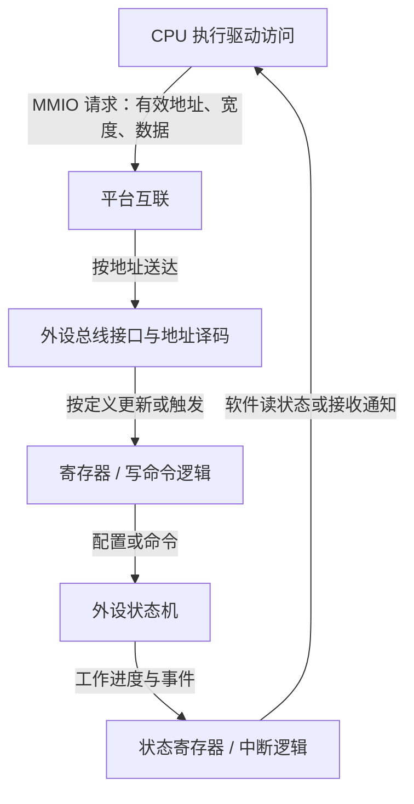

# S1-04：寄存器与 MMIO

## 课程信息

- 课程 ID：S1-04；模块：02 处理器与存储。
- 前置：[S1-03 地址空间](Address_Spaces_and_Mapping.md)，用户已于 2026-10-17 确认掌握。
- 日期：2026-10-17（Asia/Shanghai）。
- 范围：外设寄存器通用模型、教学设定与 Linux v6.8 公开访问机制。
- 没有指定 SoC/Sensor，不提供真实寄存器地址、位定义或固定时序。
- 学习状态见 [Progress.md](../Progress.md)，不能因正文生成就标记掌握。

## 本课目标

能解释 CPU 经 MMIO 写外设寄存器后硬件如何响应，区分软件发起、写事务到达与任务完成，并依据寄存器语义选择修改和确认方法。

## 1. 寄存器是硬件提供的软件接口

本课的 Register 指外设控制、状态与数据接口，不讨论 CPU 内部通用寄存器。
可以先理解为：硬件把一组配置、状态或数据访问规则暴露出来，软件按规则读写，硬件逻辑据此工作或返回结果。
寄存器接口不一定对应一个普通存储单元；读取可能返回实时状态，写入可能触发动作，也可能访问 FIFO。

| 类别 | 软件用途 | 可能的硬件行为 |
|---|---|---|
| 控制/配置 | 设置模式、使能或发命令 | 保持配置，或向状态机提供命令/条件 |
| 状态 | 判断忙、完成、错误等 | 硬件随工作进度更新，或锁存事件 |
| 数据/FIFO | 收发小量数据 | 读取/写入可能取出/加入一项数据 |
| 标识 | 读取模块版本、ID 等 | 返回硬件定义的识别信息 |

一份寄存器手册通常要查：位置、访问宽度、位域、读写语义、复位值、保留位要求、时序依赖和生效条件。
寄存器名字中有 STATUS 或 CTRL 不是足够依据；同一寄存器内不同位也可能有不同访问规则。

## 2. MMIO 如何把 CPU 的访问送到外设

MMIO（Memory-Mapped I/O，内存映射 I/O）把 CPU 地址空间的一部分解释为设备访问，而不是普通 RAM 读写。
因此 CPU 执行相应访问时，平台按有效映射和地址选择，将请求送到外设接口；接口再根据寄存器位置和访问规则处理。
Linux 官方设备 I/O 文档给出 MMIO 的定义以及映射和访问接口。[Linux v6.8 Device I/O](https://www.kernel.org/doc/html/v6.8/driver-api/device-io.html)

以下是简化逻辑控制图，不是电气连接图；省略缓存/转换细节、跨时钟域和各类失败处理。



CPU 不需要在软件中模拟整个外设；它通过配置与命令组织工作，外设逻辑执行其职责。
寄存器写入是否立即生效、是否需要时钟、是否需等待空闲或更新触发，取决于硬件手册。

## 3. Linux 中先有有效资源，再使用访问接口

在 Linux 语境中，驱动通常从设备资源取得寄存器区域，通过合适的映射机制取得 I/O 地址，再按宽度和语义使用接口。
例如 `readl()` / `writel()` 是常见的 32 位 MMIO 访问接口；具体端序和设备要求仍要匹配。

下面只是 Linux 概念片段：假设这些 I/O 地址已正确取得且资源可用，目标寄存器为适合这些接口的 32 位寄存器，命令值来自实际手册。

```c
/* 映射、资源管理和错误处理不在此片段中。 */
writel(start_command, command_reg);
status = readl(status_reg);
```

片段没有给出实际地址、位定义或完整等待流程，也没有证明任务已经完成。
`__iomem` 在 Linux 中表示 I/O 地址使用约束，不把它当作可随意解引用的普通 RAM 指针。
适用接口和资源映射见 [S18](../Sources.md#s18-linux-mmio-设备访问)。

不能把手册物理地址直接强转为任意指针，就认为映射、访问权限、设备状态和访问规则都已满足。
裸机/RTOS SDK 可能采用不同的寄存器访问封装，不直接照搬 Linux API。

## 4. 位域：一次写入可能影响多个配置

寄存器通常按 bit 或多 bit 字段表达功能。掩码 Mask 用来选取字段，而不是改变寄存器访问语义。
以下为纯教学 RW 模型：某个可正常读取的配置寄存器，目标字段允许普通读改写，无读写副作用，其他位按手册规则保留，软件已处理并发。

```text
旧值 = 读取配置寄存器
新值 = (旧值 AND NOT 字段掩码) OR (已移位的新字段位 AND 字段掩码)
写入新值
```

这就是 RMW（Read-Modify-Write，读改写）：先清掉旧字段，再填入新字段，保留其他允许保留的位。
如果直接把整个寄存器写成“目标字段的值”，可能把其他配置一起覆盖。

但 RMW 不是通用解法：
- 读出到写回之间，其他线程或固件可能修改同一寄存器，造成更新丢失。
- 硬件可能在此期间更新状态；软件锁并不自动阻止硬件变化。
- 保留位、只写位、清除位或命令位可能不允许这种操作。

实际应按平台的锁、专用 SET/CLEAR 接口、影子状态或其他硬件协议处理；不能假定每个设备都有同一种办法。

## 5. 读写语义决定这个值是什么意思

| 标记/机制 | 常见含义 | 软件关注点 |
|---|---|---|
| RO，Read-Only | 软件只读 | 不把写入当成配置机制，具体非法写行为查手册 |
| RW，Read/Write | 允许按定义读取和写入 | 是否普通存储语义，是否有锁定、生效和并发条件 |
| WO，Write-Only | 只允许写 | 不能依赖读回构造新值或确认保存内容 |
| W1C，Write One to Clear | 对应位写 1 清零，写 0 不执行该清除 | 要写希望清除的位掩码，不是目标状态值 |
| Read-to-clear | 读取导致指定状态清除 | 日志或调试工具多读一次可能改变后续观察 |
| 自清命令位 | 写入触发动作后由硬件清回 | 读回为 0 未必意味着写入失败 |

这些是常见机制，不是所有寄存器统一采用的规则。Open-CMSIS-SVD 明确描述 `oneToClear` 及读取副作用等元数据；真实行为仍以器件定义为准。[SVD 寄存器语义](https://open-cmsis-pack.github.io/svd-spec/latest/elem_registers.html)

### W1C 教学例子

假设一个教学状态寄存器只关心两个事件位 A、B，二者都为 W1C；本例其他位按定义允许写 0。
现在 A=1、B=1，只想确认并清掉 A，保留 B。

```text
写入：A 位为 1，B 位为 0
结果：A 被清除；本次写入不清除 B
```

这里不使用真实芯片位号或数值。不能把读出的 A=1、B=1 原样写回，否则两个事件都可能被清除。
也不能把 A 位在旧值中改为 0、B 保持 1 后写回，那会保留 A 而清掉 B，结果与意图相反。
如果有并发事件，置位与清除同时发生的优先关系、事件是否计数等还需核对手册，不能靠 W1C 名称推定。

### 区分写清除与读清除

W1C 描述“写 1”触发清除；read-to-clear 描述“读取”触发清除，是两个不同访问动作的规则。
本题假设没有读取清除副作用，因此读取 A=1、B=1 本身不清掉它们；把这个读值原样写回才会同时清掉 A、B。
不能仅凭 W1C 名称推定读取会清除，或推定读取一定无副作用。真实器件需分别核对读行为和写行为，二者也可能在同一设计中分别定义。

本教学例进一步假设没有新事件，按时序观察硬件状态：

| 时刻或动作 | A 的硬件状态 | B 的硬件状态 |
|---|---|---|
| 初始 | 1 | 1 |
| 读取后，尚未写回 | 1 | 1 |
| 原样写入 A=1、B=1，清除生效后 | 0 | 0 |

写入的 `1` 是清除对应位的请求，不是要求该状态位保存为 `1`；向 W1C 位写 `0` 则不清除该位。需区分软件写入值与操作后的硬件状态。

## 6. 软件发起、写到达与工作完成是不同阶段

用一个虚构的采集控制器作教学模型：软件写 START 后，控制器等待条件、启动工作，最终以状态/事件报告完成。
START、BUSY、DONE 只是教学角色名称，实际器件可能用不同接口，不提供任何地址或位号。

```text
驱动发出写请求
  → 写事务按平台规则到达外设
  → 硬件接受命令并在条件满足时执行
  → 本次任务完成或失败
  → 软件通过状态/中断等确认结果
```

不能仅凭写接口返回、某个命令位读回值，或一条“start success”日志，就把后面所有阶段当作成功。
Linux I/O 资料讨论了某些平台/总线中的 posted write：发出写入与目标设备收到写入可能分离；具体读回和排序规则按平台使用。
这不代表每次 MMIO 都要额外读回，也不代表读任意寄存器都安全。[Linux v6.8 I/O 访问与 posted writes](https://www.kernel.org/doc/html/v6.8/driver-api/device-io.html)

内存屏障/访问接口保证的是其定义的顺序和可见性，不会代替外设完成一帧采集。[Linux v6.8 Memory Barriers](https://www.kernel.org/doc/html/v6.8/core-api/wrappers/memory-barriers.html)
确认任务完成需要手册定义的本次完成条件，检查错误状态，必要时使用有超时的等待和异常恢复。
还要避免把上一轮残留的 DONE 状态误认为本次完成；清状态和启动的顺序按实际协议，不给通用固定步骤。

## 7. volatile 的边界

某些裸机 SDK 用 `volatile` 修饰寄存器结构，约束编译器对这些访问的处理；具体访问语义依语言实现和平台。
它不能代替正确映射、设备内存属性、访问宽度、并发控制或硬件完成条件。
Linux 驱动应按平台 I/O 接口规则访问，而不是自行加 `volatile` 后绕开接口。[Linux v6.8 volatile 说明](https://www.kernel.org/doc/html/v6.8/process/volatile-considered-harmful.html)

## 8. 与 Sensor 寄存器的关系

SoC 控制器寄存器与 Sensor 内部寄存器都可能有位域及访问副作用，但到达它们的路径不同。
控制器 MMIO 写完成，不等于 I2C/I3C 事务成功；总线事务成功，也不必然意味着 Sensor 已产生有效图像。
Sensor 接受配置后是否延迟生效、是否需分组更新、是否应等待帧边界，必须查 Sensor 资料，不能当成所有器件共同规则。
地址和路径见 [S1-03](Address_Spaces_and_Mapping.md)，下一课 [S1-05](Controllers_and_Buses.md) 继续连接控制器、片上互联与外部总线。

## 9. 工程锚点：启动接口返回成功，但没有帧完成

类型：模拟教学问题，没有真实产品测量或已确认根因。

### 现象

假设启动接口返回成功，但预期时间内软件没有收到帧完成通知。

### 系统背景

接口返回值的契约、本轮命令是否到达、外设依赖、Sensor 输出和通知路径均待核对。

### 相关原理

软件提交成功、命令到达、任务完成与通知送达不是一个条件；状态寄存器的读写也可能有副作用。

### 可能原因

1. 返回值只表示请求提交成功，调用方却当成同步任务完成。
2. 外设电源/时钟/复位或启动前置未满足，命令未产生预期工作。
3. 命令/状态位访问规则使用错误，或把旧完成状态当成新状态。
4. 数据链没有有效输出，或硬件已完成但通知被屏蔽/未处理。

优先级按接口契约和基础依赖安排，不声称这些分支已被验证。

### 验证方法

先查接口和手册；在合法时机记录本轮请求、可安全观察的状态和错误，再关联数据通路与通知时间线。
日志避免重复读取 read-to-clear/FIFO 等有副作用资源；状态若被读取清除，保留已读取快照用于后续记录。
必要时核对总线/信号及中断路径，具体寄存器和测量要求依平台资料。

### 定位过程

当前只有教学设定，无实际实验结果，不宣布根因。

### 解决方案

按证据选择：修正调用方对返回值的解释、满足启动依赖、按正确语义配置/清状态、修复通知或数据通路。
等待应有超时和失败处理；未测量前不以增加固定延时作为已验证修复。

### 经验总结

为每个“成功”说明具体阶段；用本轮任务证据确认状态，不把软件日志直接等同于硬件结果。
关联 [Bring-up 方法](../09_Debugging_Bringup/README.md) 和 [Camera](../05_Camera/README.md)，不重复生成独立案例。

## 10. 理解检查

1. CPU 写入启动命令，写接口已返回，能否认定一帧采集已经完成？还应观察什么？
2. 普通 RW 配置寄存器有多个字段，只想修改其中一个字段，为什么不能直接用目标字段的值覆盖整个寄存器？使用读改写要先确认哪些条件？
3. 教学寄存器中 A/B 均为 W1C 且当前都为 1，只想清 A，A/B 分别应写什么？为什么不能把读值原样写回？

仅按实际回答更新进度，不因课程生成、引用或代码片段存在而标记掌握。

## 关联课程与来源

- [前一课 S1-03](Address_Spaces_and_Mapping.md)、[课程路线](../Roadmap.md)、[术语速查](../Glossary.md)。
- [下一课 S1-05](Controllers_and_Buses.md)：控制器、片上互联与总线，沿一次 Chip ID 读取区分软件请求和外部事务。
- S18 于 2026-10-17 复核；S20～S22 为本课新增公开依据，版本与限制见 [Sources.md](../Sources.md)。
- 所有教学角色和位状态均显式设定，不代表实际 SoC 或 Sensor 寄存器参数。
